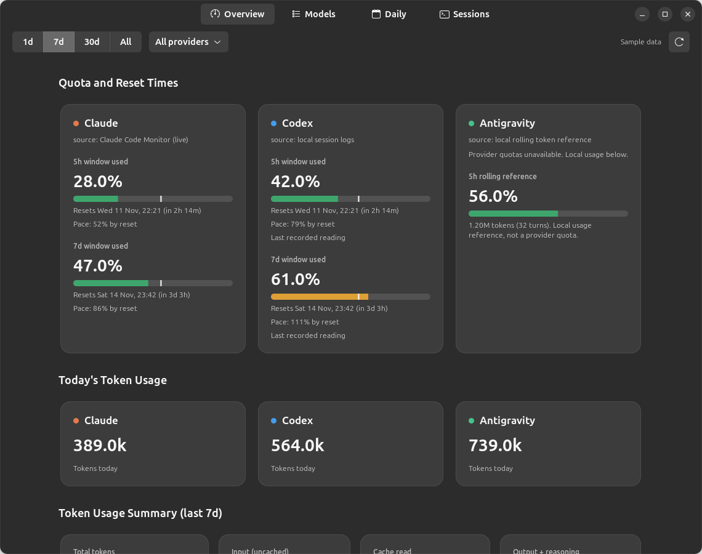
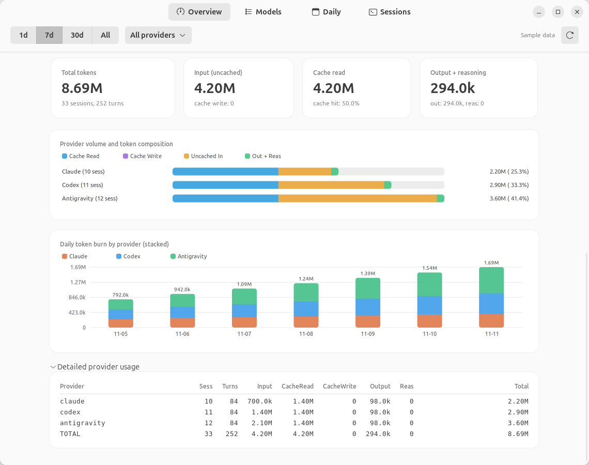

# AI Usage

AI Usage is a Linux desktop dashboard, terminal dashboard, and CLI for Claude Code, Codex, and
Antigravity. The GTK dashboard shows provider quota, reset times, projected
usage at reset, and tokens recorded today. The Models, Daily, and Sessions tabs
show the underlying usage breakdowns.

## Screenshots

Native GTK dashboard with sample data.



Quota windows, reset times, and today's tokens in the dark theme.



Token composition, daily usage, and expanded provider details in the light theme.

## Build and run

Install Pixi and the following system dependencies. Package names vary by
distribution.

- A C11 compiler, CMake 3.20 or later, Ninja, and pkg-config
- Development libraries for SQLite3, GTK4, Libadwaita, and ncursesw

```text
pixi run gui
```

To install the dashboards, CLI, desktop launcher, and icons under `~/.local`,
run `pixi run install`, then open the AI Usage launcher entry. The generated
launcher uses the absolute installed executable path. You can also run
`~/.local/bin/ai-usage-gtk` directly.

## CLI and tests

| Command | Result |
| --- | --- |
| `pixi run usage` | Usage and quota summary |
| `pixi run tui` | Interactive terminal dashboard |
| `pixi run models` | Token counts by model |
| `pixi run daily` | Daily usage totals |
| `pixi run sessions` | Recent sessions |
| `pixi run json` | Machine-readable report |
| `pixi run test` | Build and run core and terminal tests |

## Terminal dashboard

Run `pixi run tui` in an interactive terminal, or run the installed
`~/.local/bin/ai-usage-tui`. Overview shows summary metrics and provider cards
with quota bars, reset times, projected usage, reading sources, and token totals.
Cards sit side by side at 120 columns and above, and stack in narrower terminals.
The Catppuccin Mocha palette uses muted borders with peach, blue, and green
provider accents; projections above 100% use soft rose text. The vertical bar
marker shows elapsed window time. Custom terminal colors are restored on exit.
Antigravity local rolling windows show tokens and turns rather than quota percentages.
Models and Daily show token breakdowns;
Sessions shows recorded sessions. Below 135 columns, token tables show turns,
total, input, and combined output plus reasoning; wider terminals also show
cache and separate reasoning counts. Session totals appear before model names.
Long fields clip at display-cell boundaries; resize wider to see more detail.
UTF-8 locales use rounded card borders and fractional block bars. Other locales
use ASCII borders and bars, and terminals without color use monochrome styling.

| Key | Action |
| --- | --- |
| `1` - `4`, `Tab` | Select Overview, Models, Daily, or Sessions |
| `j` / `k`, down / up | Scroll one row |
| `PageDown` / `PageUp`, `Home` / `End` | Scroll by page or jump to either end |
| `p` | Cycle all, Claude, Codex, and Antigravity |
| `d` | Cycle 1, 7, 30 days, and all time |
| `r` | Refresh usage |
| `q` | Quit |

The default is seven days, all providers, and automatic refresh every 60 seconds.
Options are `--days N`, `--all`, `--provider all|claude|codex|antigravity`,
and `--refresh SECONDS` (`0` disables automatic refresh). `--help` lists the
options and controls. Provider filtering uses the collected report immediately;
changing days collects a new report. The previous report stays visible during
refresh. Collection runs on a worker so navigation remains responsive. On exit,
the terminal is restored before waiting for any running collection to finish.

## Quota readings

- Claude quota comes from the local Claude Code Monitor socket. With an updated
  monitor that supports the quota-only snapshot, the dashboard can read Claude
  Code's status-line quota even if the monitor's CLI poll fails. The updated
  monitor also polls quota independently through its installed OAuth API reader,
  avoiding the local conversation scan. It polls every two minutes, and the API
  reader caches responses for three minutes. Older monitors
  still work through the regular snapshot. Saved readings from
  `~/.claude/usage-history.jsonl` are used when a live window is unavailable.
- Codex quota comes from local session logs and refreshes when Codex records a
  new quota snapshot.
- Antigravity provider quota comes from its CLI when available. The dashboard
  labels local rolling usage separately.

The pace estimate extrapolates the average usage rate in the current quota
window. A projection over 100% means that pace would exhaust quota before reset.
